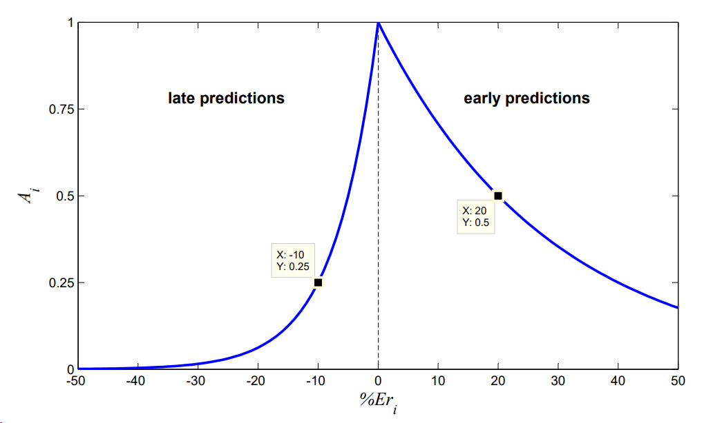
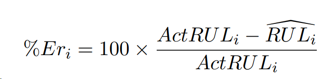
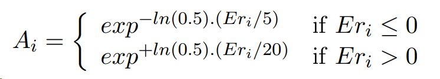

# High-innovation Model BiLSTM-KAN Network for Bearing Life Prediction, Python Code

For more details, please refer to: High-Innovation Model BiLSTM-KAN Network for Bearing Life Prediction, Python Code
Following the previous articles on bearing life prediction, this issue introduces a new model for life prediction.
Previous articles on bearing life prediction are as follows:
Bearing Life Prediction Based on Stacked Denoising Autoencoder (SDAE) in MATLAB
Bearing Life Prediction with Transformer-LSTM Network: A Comprehensive Tutorial!
The above two articles are MATLAB codes, and many backers have asked if there is any Python code. This issue will not only present a Python-based model but also introduce a highly innovative one - BiLSTM-KAN.
The model introduced in this issue is built on PyTorch, consistent with the approach of the previous two articles on bearing life prediction. Next, I will provide a detailed introduction.
Let's first discuss the PHM2012 dataset.
Points to note in the PHM2012 dataset
There are many online introductions to the PHM2012 dataset, and I have also included an official document introduction about this data in the code compression package. For a basic introduction to the PHM2012 dataset, you can refer to this link: https://zhuanlan.zhihu.com/p/583606882
This only discusses how to use this dataset! I've seen many articles online that have made the wrong mistakes!
First, attach a picture of the PHM2012 dataset:
\n        \n  
Here, we will illustrate with Case 1. Firstly, the official PHM2012 dataset documentation mentions that in the training set Bearing1_1 and Bearing1_2, both bearings have transitioned from a healthy state to complete failure. If health metrics are quantified using a 0-1 scale, then the moment of complete failure corresponds to 1. The crux of the matter now!
The test set Bearing1_3~Bearing1_7, although also transitioned from a healthy state to complete failure, does not represent the entire dataset from health to total failure as provided by the official data. Instead, it is cut off just before complete failure! Therefore, the end of the test set data does not represent the full failure state, and health indicators cannot be directly mapped to 1. Here are the actual time frames required for the test set to reach complete failure, which represents the true remaining lifespan:

Next steps involve using the training set to train a deep learning network model, then feeding the test set into the model for prediction. The focus now is on smoothing the prediction results first, followed by fitting the filtered curve with methods such as least squares, to determine when the fitted curve reaches the failure threshold. Finally, compare this time frame with the actual lifespan shown in the image above to assess the quality of your model!

The official documentation also provides a scoring rule:

After understanding this part, let's move on to the current model prediction results!
BiLSTM-KAN Network for Bearing Life Prediction

Regarding the BiLSTM-KAN network model:
The KAN network is a very popular model recently, distinct from traditional MLP architectures. It achieves higher accuracy with fewer parameters in mathematical and physical problems. The inspiration for KAN comes from the Kolmogorov-Arnold theorem, which means that any multivariable continuous function can be expressed as combinations of single variable functions.

The core feature of KAN is the learnable activation function at the edge (i.e., weight) of the network, unlike traditional MLPs which use fixed activation functions at the nodes (i.e., neurons). Furthermore, KAN has better accuracy and interpretability than MLPs.

**KAN's advantages include:**
1. KAN avoids the catastrophic forgetting problem of large models
2. KAN is more accurate than MLP in function fitting and partial differential equation solving.
3. KAN can be visualized intuitively. KAN provides interpretability and interactivity that MLP cannot offer.
4. The disadvantages of KAN are:
1. Training speed is slow because training an activation function requires an infinite number of loops for validation.
2. Whether the interpretability of deeper structures still exists is only demonstrated in the paper as shallow, not deep.
3. KAN networks are more precise in solving nonlinear functions and other engineering problems, but they are very slow in time series prediction. However, it can still be improved as a small point in the network.
This issue brings the BiLSTM-KAN network, which is based on the BiLSTM model, replacing the last fully connected layer of the basic BiLSTM model with the KAN network to increase the model's fitting ability.
The detailed process of this issue is included in the code package, and the method of obtaining it is mentioned at the end!
The code process of this issue is:
Step 1: Read the PHM2012 dataset and plot the time domain waveforms of various bearings. In this issue, we use the horizontal signals of Bearing1_1 and Bearing1_2 as the training set and the horizontal signals of Bearing1_3 and Bearing1_4 as the test set. The time domain waveforms of Bearing1_1~Bearing1_4 have been drawn out, here only show Bearing1_1:
\n        \n  
Step 2: Fast Fourier transform (FFT) is performed on the data obtained in the first step, here only show the result of the first data of Bearing1_1 after FFT transformation:
\n        \n  
Step 3: The processed data from Step 2 is sent to the BiLSTM-KAN network for training.
The FFT signal is first fed into a BiLSTM to perform feature learning on the data, replacing the final fully connected layer with a KAN network to further enhance the model's fitting capability. Here, during training, Bearing1_1 and Bearing1_2 are used as the training set, while Bearing1_3 and Bearing1_4 are used as the test set.
Step 4: Applying smoothing filter to the prediction results, and the predicted results of Bearing1_3 and Bearing1_4 along with the smoothed curve are shown in the following figure.
\n        \n  
\n        \n  
Step 5: Polynomial fitting of the smooth curve and predicting remaining life
The prediction results for Bearing1_3 are as follows:
\n        \n  
Here, I'll briefly explain how to understand this image.
1801 represents the official end-of-life (EOL) of Bearing 1_3, meaning that by reaching this point in time, the bearing has not yet completely failed. The pink dashed line represents the curve smoothed with a prediction filter, while the blue dashed line represents the curve fitted to the smoothed data. By predicting the blue fitted curve, we can determine when the bearing will fail based on the model's predictions. The black line represents the actual lifespan of the bearing; it is evident that the actual failure time was at 2374 seconds, whereas our model predicts a failure time of 2064 seconds, indicating an excellent predictive accuracy!
The prediction results for Bearing1_4 are as follows:
\n        \n  
Similarly, the predicted failure time is only 1477-1435=42s away from the actual failure time. The above two predictions do not require secondary adjustments and can directly generate images with one click!
Code directory screenshot:
\n        \n  
Code Directory Explanation:
This tweet can be referenced for two documents, which will further aid in understanding the procedures of this article.
[1] Wang Yujing, Li Shaopeng, Kang Shouchang, et al. Prediction Method of Remaining Lifespan of Rolling Bearings Based on CNN and LSTM [J]. Vibration. Testing and Diagnosis, 2021, 41(03): 439-446+617. DOI: 10.16450/j.cnki.issn.1004-6801.2021.03.003.
[2] Li Chunxiao. Research on Bearing Fault Diagnosis and Remaining Life Prediction Based on Transformer [D]. Shijiazhuang University of Railway, 2023. DOI: 10.27334/d.cnki.gstdy.2023.000614.

## Images

<!-- PAYMENT_BLOCK -->

## Get this dataset

- Payment link (Stripe): [Buy now](https://buy.stripe.com/3cs8yP7sY87d0vu9AB)
- Payment QR code: 

<!-- /PAYMENT_BLOCK -->
